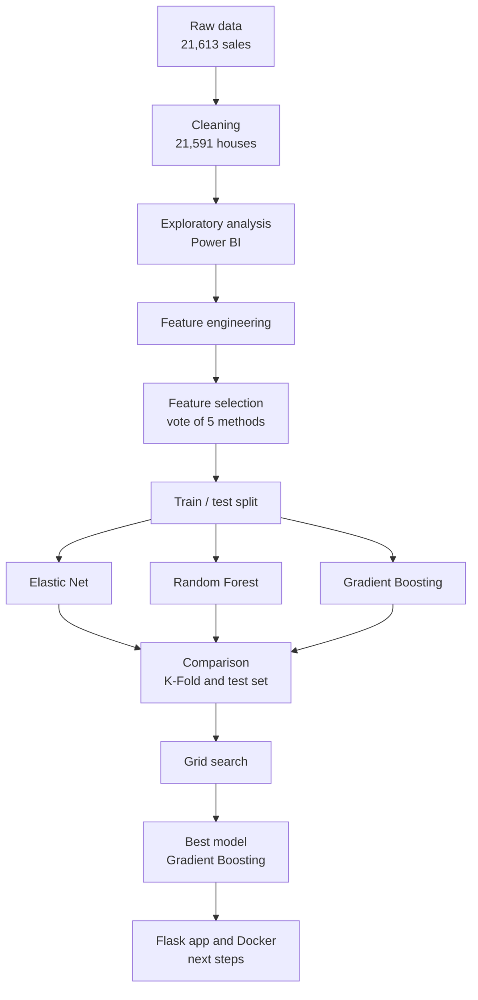
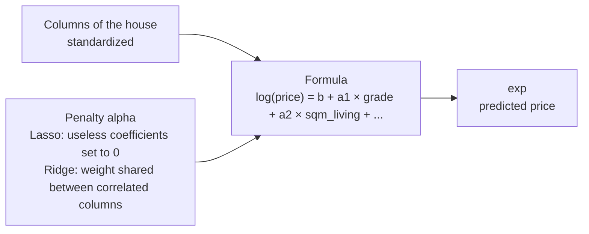
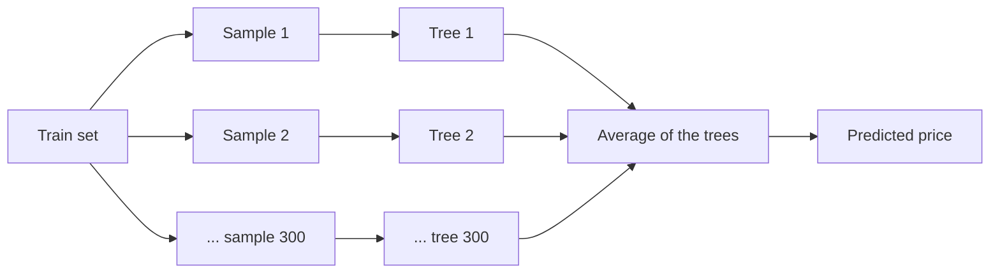
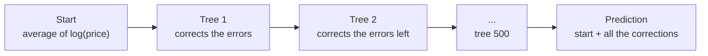
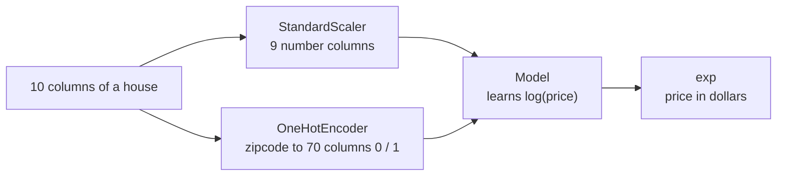
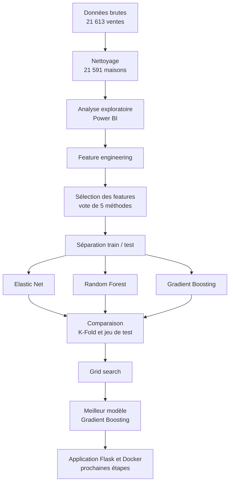
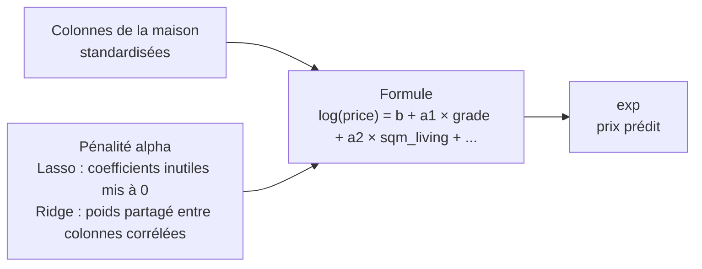
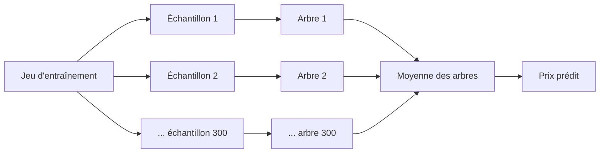
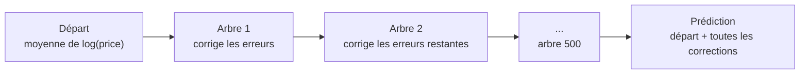
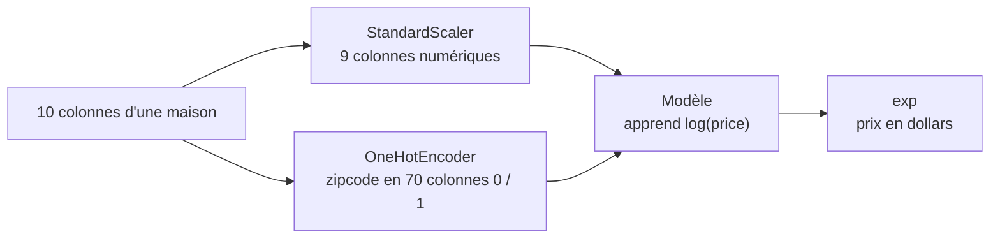

# apartment-hunter

Estimating the sale price of a house in King County (Seattle area, USA) with regression models.
*Estimer le prix de vente d'une maison du comté de King (région de Seattle, États-Unis) avec des modèles de régression.*

**[English](#english)** · **[Français](#francais)**

---

# English version

## Context

A real estate agent spends a lot of time estimating the price of houses for the owners who want to sell them. In this school project, inspired by the TV show *Chasseurs d'appart'*, a former data scientist who became a real estate agent builds a tool that estimates the price of a house from its characteristics, to stand out from the competition.

**Problem statement:** can we estimate the sale price of a house in King County from its characteristics, and how accurate is this estimate?

To answer it, we cleaned and explored a real dataset of house sales, studied several regression algorithms, selected the most useful features, then trained, compared and tuned three models. The best model will be deployed in a Flask web application, packaged with Docker.

## Project structure

| File / folder | Content |
|---|---|
| `data/raw/` | Raw data (King County, and Madrid, which was not used) and their descriptions |
| `data/clean/kc_house_data_clean.csv` | Cleaned data, used by the Power BI dashboard |
| `data/clean/kc_house_features.csv` | Data after the feature engineering, used for the feature selection and the models |
| `analysis_explo.pbix` | Power BI dashboard (exploratory analysis) |
| `notebook.ipynb` | Cleaning, feature engineering, feature selection, training, comparison and grid search |
| `notebook_conclusion.ipynb` | Research (watch) on 8 regression algorithms, with one diagram per algorithm |
| `models/best_model.joblib` | The best model (tuned Gradient Boosting), ready to be used by the Flask app |
| `app.py` | Flask application (step 11, to do) |
| `flask.dockerfile` | Dockerfile of the application (step 12, to do) |
| `requirements.txt` | Python libraries needed by the project |

## Progress

| Step | Status |
|---|---|
| Data cleaning | Done (`notebook.ipynb`, part 1) |
| Exploratory analysis | Done (`analysis_explo.pbix`), PDF export to add |
| Research on regression algorithms | Done (`notebook_conclusion.ipynb`) |
| Feature engineering and feature selection | Done (`notebook.ipynb`, parts 2 and 3) |
| Training and comparison of 3 models | Done (`notebook.ipynb`, part 4) |
| Grid search | Done (`notebook.ipynb`, part 5) |
| Flask application | To do |
| Docker | To do |

## Approach

## Data and analysis

### The dataset

The King County dataset (`data/raw/kc_house_data.csv`) contains **21,613 house sales** from May 2014 to May 2015, described by 21 columns: price, bedrooms, bathrooms, living area, lot area, floors, waterfront, view, condition, construction grade (`grade`, from 1 to 13), year built, year renovated, zipcode, latitude, longitude, and the living and lot areas of the 15 nearest neighbours (`sqm_living15`, `sqm_lot15`).

### Cleaning

The cleaning is done in `notebook.ipynb` (parts 1 and 2), where each choice is explained.

| Step | Decision | Reason |
|---|---|---|
| Missing values | None found | Nothing to impute |
| `id` and `date` | Dropped | An identifier tells nothing about the price, and all the sales happen within one year |
| Units | Square feet converted to square meters (`sqft_*` → `sqm_*`) | Metric units, the usual ones in France |
| Anomalies | 17 rows dropped | A house with 33 bedrooms for 150 m² (typo), and houses with 0 bedroom or 0 bathroom (missing values written as 0) |
| Duplicates | 5 rows dropped | Rows present twice (same position, same characteristics, same price) would count twice in the training |
| Price outliers | 217 detected by 3 methods at once (IQR, modified Z-score, percentiles), **kept** | They are real luxury houses (up to 7.7 million \$), not errors. Their weight is reduced by modeling `log(price)` |
| Price per m² | Kept for Power BI, **excluded from the models** | Computed from the price: a model would read the answer in its inputs (data leakage) |

After the cleaning, **21,591 houses** remain.

### Exploratory analysis (Power BI)

The dashboard `analysis_explo.pbix` studies the link between the price and each characteristic. Main findings:

- **The price is very skewed**: median of 450,000 \$, mean of 540,000 \$, maximum of 7,700,000 \$ (skewness of about 4). A few luxury houses are far above the others.
- **Size and quality**: the price is mostly linked to the living area (correlation of 0.70) and to the construction grade (0.67). The median price goes from about 200,000 \$ for the lowest grades to almost 3,000,000 \$ for grade 13.
- **Location**: the most expensive houses are around Seattle and Bellevue. The median price goes from 235,000 \$ (zipcode 98002) to 1,892,500 \$ (98039), and the median price per m² from about 1,600 \$ to 6,100 \$ depending on the zipcode.
- **Waterfront and view**: a waterfront house is worth 3 times more (median of 1,400,000 \$ against 450,000 \$), and the median price goes from 432,000 \$ without a view to 1,185,000 \$ with the best view.
- The lot area and the year of construction have almost no straight-line link with the price (correlations below 0.1).

### Feature engineering

| Column | Decision | Reason |
|---|---|---|
| `house_age` | Created: 2015 − `yr_built` | The price depends on the age of the house |
| `is_renovated` | Created: 1 if `yr_renovated` > 0, else 0 | In `yr_renovated`, 0 means "never renovated", it is not a year |
| `sqm_above`, `sqm_basement` | Dropped | `sqm_living = sqm_above + sqm_basement`: the same information twice |
| `zipcode` | Kept as one column, encoded inside the models | It is a code, not a quantity (98039 is not "more" than 98001). The models turn it into one 0 / 1 column per zipcode (one-hot encoding), so the Flask app can simply send a zipcode |

No pair of columns has a correlation above 0.8 (multicollinearity check).

### Feature selection

After the feature engineering, 15 candidate columns remain (plus `zipcode`). Each selection method looks at the data from a different angle, so we organised a **vote**: a column is kept if at least 3 voters out of 5 say yes. The selection only looks at the train set, with `log(price)` as the target.

| Voter | Question | Columns kept |
|---|---|---|
| Power BI | Does the chart show a link with the price? | 13 |
| Correlation | Is the straight-line link with `log(price)` at least 0.1? | 11 |
| Random Forest importance | Is the column above the average importance? | 3 |
| Boruta | Is the column more useful than a shuffled copy of the columns (pure noise)? | 12 |
| Forward selection | Does adding the column still improve the R² by at least 0.001? | 8 |

| Votes | Columns | Decision |
|---|---|---|
| 5 / 5 | `grade`, `sqm_living`, `lat` | Kept |
| 4 / 5 | `waterfront`, `view`, `sqm_living15` | Kept |
| 3 / 5 | `bathrooms`, `sqm_lot`, `long` | Kept |
| 2 / 5 or less | `bedrooms`, `floors`, `condition`, `house_age`, `is_renovated`, `sqm_lot15` | Dropped |

**Checks** (R² on `log(price)`, cross-validation on the train set):
- With a Random Forest: 0.881 with the 15 candidates, **0.879 with the 9 selected columns**, 0.779 with the 3 unanimous columns only. The selection keeps the score with 6 columns less.
- `zipcode` raises the R² of a linear regression from 0.736 to **0.868**, and barely changes the Random Forest (0.879 → 0.880). It is essential for Elastic Net (a linear model) and harmless for the trees, so it is kept.

**Final features (10):** `grade`, `sqm_living`, `lat`, `long`, `waterfront`, `view`, `sqm_living15`, `bathrooms`, `sqm_lot` and `zipcode`. They cover the three ideas of the exploration: the **size**, the **quality** and the **location**.

## Algorithms used

The three models were chosen after the research on regression algorithms (see [Watch](#watch)).

### Elastic Net

A **linear model**: it predicts with a formula `log(price) = b + a1 × grade + a2 × sqm_living + ...`. During the training, it looks for the coefficients that make the smallest errors, **plus a penalty** that keeps the coefficients small:
- the **Lasso** part can set the coefficient of a useless column exactly to 0,
- the **Ridge** part shares the weight between correlated columns.

`alpha` sets the strength of the penalty, and `l1_ratio` the mix between Lasso and Ridge. Elastic Net is fast and easy to interpret, but it gives each column a fixed effect.

### Random Forest

Many **decision trees** that learn independently, each one on a random sample of the houses (**bagging**). Each tree guesses the price by asking yes / no questions (*"is `grade` above 8?"*). The prediction is the **average of all the trees**: the errors of the individual trees compensate each other.

### Gradient Boosting

Small trees built **one after the other** (**boosting**): each new tree learns to correct the errors left by the previous ones. `n_estimators` sets the number of trees, `max_depth` their size, and `learning_rate` how much each tree corrects.

### Preparation pipeline

The three models get exactly the same preparation, chained in a scikit-learn pipeline:

- **Standardization** (`StandardScaler`): each number column is centered and scaled, which is necessary for the penalty of Elastic Net.
- **One-hot encoding** (`OneHotEncoder`): `zipcode` becomes one 0 / 1 column per zipcode.
- **Log of the price** (`TransformedTargetRegressor`): the models learn `log(price)`, which reduces the weight of the luxury houses (an error of 10% counts the same for every house), and their predictions are turned back into dollars.

In a pipeline, the standardization is learned on the training houses only, so no information leaks from the test set (no data leakage).

### Evaluation

- **Split**: 80% of the houses to train (17,272), 20% to test (4,319), always the same split (`random_state=42`).
- **K-Fold cross-validation** (5 folds) on the train set to compare the models, then a final evaluation on the test set.
- **Grid search** (`GridSearchCV`) with the same 5 folds, keeping the settings with the lowest MAE.

| Metric | Meaning | Direction |
|---|---|---|
| MAE | Average error, in dollars | Lower is better |
| MAPE | Average error, in % of the price | Lower is better |
| RMSE | Like the MAE, but the big errors count more | Lower is better |
| RSS | Sum of the squared errors | Lower is better |
| R² | Share of the price differences explained by the model (1 = perfect) | Higher is better |

## Results

### Default settings

5-fold cross-validation on the train set, with the default settings of scikit-learn:

| Model | R² | MAE | MAPE |
|---|---|---|---|
| Elastic Net | −0.04 | 220,632 \$ | 43.7% |
| Random Forest | 0.869 | 71,168 \$ | 13.1% |
| Gradient Boosting | 0.856 | 75,798 \$ | 14.0% |

With its default penalty (`alpha = 1`), Elastic Net sets all its coefficients to 0 and predicts the same price (about 464,000 \$) for every house. Random Forest is the best for now, but it learns the training houses by heart (R² of 0.98 on them).

### Grid search

| Model | Settings tested | Best settings | MAE in cross-validation |
|---|---|---|---|
| Elastic Net | `alpha` (6 values from 0.00001 to 1) × `l1_ratio` (0.1, 0.5, 0.9, 1) | `alpha` = 0.00001, `l1_ratio` = 0.5 | 220,632 \$ → **79,205 \$** |
| Random Forest | `n_estimators` (100, 300) × `max_features` (0.2, 0.33, 0.5) | 300 trees, `max_features` = 0.33 | 71,168 \$ → **69,644 \$** |
| Gradient Boosting | `n_estimators` (100, 500) × `max_depth` (3, 5), with `subsample` = 0.8 | 500 trees, depth 5 | 75,798 \$ → **66,358 \$** |

### Final comparison on the test set

The tuned models on the 4,319 test houses, never seen during the training:

| Model | MAE | MAPE | RMSE | RSS | R² |
|---|---|---|---|---|---|
| Elastic Net | 80,863 \$ | 14.5% | 179,979 \$ | 1.40 × 10¹⁴ | 0.777 |
| Random Forest | 71,264 \$ | 12.9% | 141,914 \$ | 8.70 × 10¹³ | 0.861 |
| **Gradient Boosting** | **68,346 \$** | **12.6%** | **130,508 \$** | **7.36 × 10¹³** | **0.883** |

- **Gradient Boosting wins on every metric.** It is saved in `models/best_model.joblib` (2 MB) for the Flask app.
- Elastic Net makes the biggest jump (its R² goes from −0.04 to 0.777), but a straight-line formula stays behind the trees: it cannot learn combinations like "big house AND expensive area".
- The MAE of Random Forest improves a little, but its R² goes down (0.874 → 0.861): the grid search optimizes the MAE, and the chosen settings make bigger errors on a few very expensive houses.

### What drives the price

Permutation importance of the final model: each column is shuffled in turn, and we measure how much the average error grows.

| Column | Growth of the MAE |
|---|---|
| `lat` | +107,000 \$ |
| `sqm_living` | +57,000 \$ |
| `grade` | +41,000 \$ |
| `long` | +30,000 \$ |
| `zipcode` | +20,000 \$ |
| `sqm_lot` | +14,000 \$ |
| `sqm_living15`, `view`, `waterfront`, `bathrooms` | less than 9,000 \$ each |

The **location** comes first, then the **size** and the **quality** of the house.

## Conclusion

**Answer to the problem statement:** yes. The tuned Gradient Boosting estimates the price of houses it has never seen with an average error of **68,346 \$**, that is **12.6%** of the price, and it explains **88%** of the price differences (R² = 0.883).

**What we learned**
- The price of a house is mostly driven by its location, its size and its quality.
- A careful feature selection keeps the performance with fewer columns (10 instead of 16), which makes the model lighter and easier to explain.
- Default settings are not always good: Elastic Net only became useful after the grid search.
- The metric used by the grid search guides its result: optimizing the MAE favours the usual houses.
- Tree ensembles beat the linear model because they learn combinations of columns.

**Limits**
- One county, and sales from 2014-2015 only: the model does not know today's prices.
- No information about the interior, the exact neighbourhood, the schools or the transport.
- Luxury houses are rare in the data, so they are less well estimated: the cheapest houses are slightly over-estimated and the most expensive ones under-estimated.
- The model gives one price, not a range.

**Possible improvements**
- More recent data, and more location features (distance to downtown Seattle, schools, transport).
- A prediction interval ("between X and Y dollars") instead of a single price.
- Bigger grids: the best settings of Gradient Boosting are at the edge of its grid.
- Other boosting libraries, such as XGBoost (mentioned in the research).
- In the Flask app, finding the latitude and the longitude from an address.

## Watch (research)

The research on regression algorithms (step 7 of the brief) is in `notebook_conclusion.ipynb`, with one diagram per algorithm. Eight algorithms were studied:

| Algorithm | In one sentence |
|---|---|
| Linear regression | Draws the straight line that best links one variable to the target |
| Multiple linear regression | The same idea with several variables, each one with its own weight |
| Polynomial regression | Adds powers of the variables to draw a curve, with a risk of overfitting |
| Poisson regression | Made for counts (accidents, sales per shop), not for continuous prices |
| Support Vector Regression (SVR) | A linear model with an error margin (ε-tube) that ignores small errors and resists outliers |
| Gradient Boosting | Small trees built one after the other, each one correcting the errors of the previous ones |
| Random Forest | The average of many independent decision trees, robust and accurate |
| Elastic Net | A linear regression with a penalty (Lasso + Ridge) that keeps the coefficients small |

**Why Elastic Net, Random Forest and Gradient Boosting**
- **Random Forest** and **Gradient Boosting** are the two main families of tree ensembles (bagging and boosting). They learn non-linear links and combinations of columns, handle the skewed price and its outliers well, and train in a reasonable time on 21,600 houses.
- **Elastic Net** represents the linear models. It includes the simple and multiple linear regressions (with a very small penalty, it becomes a multiple linear regression), handles correlated columns, and is fast and easy to interpret: a good reference to measure what the trees bring.
- **Left out**: polynomial regression (risk of overfitting, and the number of columns explodes), Poisson regression (made for counts), and SVR (its training time grows very fast with the number of houses, which makes a grid search on 17,000 houses very long).

---

# Version française

## Contexte

Un agent immobilier passe beaucoup de temps à estimer le prix des maisons des propriétaires qui veulent vendre. Dans ce projet d'école, inspiré de l'émission *Chasseurs d'appart'*, un ancien data scientist devenu agent immobilier crée un outil qui estime le prix d'une maison à partir de ses caractéristiques, pour se démarquer de la concurrence.

**Problématique :** peut-on estimer le prix de vente d'une maison du comté de King à partir de ses caractéristiques, et avec quelle précision ?

Pour y répondre, nous avons nettoyé et exploré un vrai jeu de données de ventes de maisons, étudié plusieurs algorithmes de régression, sélectionné les caractéristiques les plus utiles, puis entraîné, comparé et optimisé trois modèles. Le meilleur modèle sera déployé dans une application web Flask, conteneurisée avec Docker.

## Structure du projet

| Fichier / dossier | Contenu |
|---|---|
| `data/raw/` | Données brutes (King County, et Madrid, non utilisé) et leurs descriptions |
| `data/clean/kc_house_data_clean.csv` | Données nettoyées, utilisées par le dashboard Power BI |
| `data/clean/kc_house_features.csv` | Données après le feature engineering, utilisées pour la sélection des features et les modèles |
| `analysis_explo.pbix` | Dashboard Power BI (analyse exploratoire) |
| `notebook.ipynb` | Nettoyage, feature engineering, sélection des features, entraînement, comparaison et grid search |
| `notebook_conclusion.ipynb` | Veille sur 8 algorithmes de régression, avec un schéma par algorithme |
| `models/best_model.joblib` | Le meilleur modèle (Gradient Boosting optimisé), prêt à être utilisé par l'application Flask |
| `app.py` | Application Flask (étape 11, à faire) |
| `flask.dockerfile` | Dockerfile de l'application (étape 12, à faire) |
| `requirements.txt` | Bibliothèques Python nécessaires au projet |

## Avancement

| Étape | État |
|---|---|
| Nettoyage des données | Fait (`notebook.ipynb`, partie 1) |
| Analyse exploratoire | Faite (`analysis_explo.pbix`), export PDF à ajouter |
| Veille sur les algorithmes de régression | Faite (`notebook_conclusion.ipynb`) |
| Feature engineering et sélection des features | Faits (`notebook.ipynb`, parties 2 et 3) |
| Entraînement et comparaison de 3 modèles | Faits (`notebook.ipynb`, partie 4) |
| Grid search | Faite (`notebook.ipynb`, partie 5) |
| Application Flask | À faire |
| Docker | À faire |

## Démarche

## Données et analyse

### Le jeu de données

Le jeu de données King County (`data/raw/kc_house_data.csv`) contient **21 613 ventes de maisons** de mai 2014 à mai 2015, décrites par 21 colonnes : prix, chambres, salles de bain, surface habitable, surface du terrain, étages, front de mer, vue, état, qualité de construction (`grade`, de 1 à 13), année de construction, année de rénovation, code postal, latitude, longitude, et les surfaces habitables et de terrain des 15 voisins les plus proches (`sqm_living15`, `sqm_lot15`).

### Nettoyage

Le nettoyage est fait dans `notebook.ipynb` (parties 1 et 2), où chaque choix est expliqué.

| Étape | Décision | Raison |
|---|---|---|
| Valeurs manquantes | Aucune | Rien à imputer |
| `id` et `date` | Supprimées | Un identifiant ne dit rien du prix, et toutes les ventes ont lieu sur une seule année |
| Unités | Pieds carrés convertis en mètres carrés (`sqft_*` → `sqm_*`) | Unités métriques, celles utilisées en France |
| Anomalies | 17 lignes supprimées | Une maison de 33 chambres pour 150 m² (faute de frappe), et des maisons à 0 chambre ou 0 salle de bain (valeurs manquantes notées 0) |
| Doublons | 5 lignes supprimées | Des lignes présentes deux fois (même position, mêmes caractéristiques, même prix) compteraient double à l'entraînement |
| Prix aberrants | 217 détectés par 3 méthodes à la fois (IQR, Z-score modifié, percentiles), **conservés** | Ce sont de vraies maisons de luxe (jusqu'à 7,7 millions de \$), pas des erreurs. Leur poids est réduit en modélisant `log(price)` |
| Prix au m² | Gardé pour Power BI, **exclu des modèles** | Calculé à partir du prix : un modèle lirait la réponse dans ses entrées (fuite de données) |

Après le nettoyage, il reste **21 591 maisons**.

### Analyse exploratoire (Power BI)

Le dashboard `analysis_explo.pbix` étudie le lien entre le prix et chaque caractéristique. Principaux constats :

- **Le prix est très asymétrique** : médiane de 450 000 \$, moyenne de 540 000 \$, maximum de 7 700 000 \$ (asymétrie d'environ 4). Quelques maisons de luxe sont très au-dessus des autres.
- **Taille et qualité** : le prix est surtout lié à la surface habitable (corrélation de 0,70) et à la qualité de construction (0,67). Le prix médian va d'environ 200 000 \$ pour les grades les plus bas à près de 3 000 000 \$ pour le grade 13.
- **Localisation** : les maisons les plus chères sont autour de Seattle et de Bellevue. Le prix médian va de 235 000 \$ (code postal 98002) à 1 892 500 \$ (98039), et le prix médian au m² d'environ 1 600 \$ à 6 100 \$ selon le code postal.
- **Front de mer et vue** : une maison en front de mer vaut 3 fois plus (médiane de 1 400 000 \$ contre 450 000 \$), et le prix médian passe de 432 000 \$ sans vue à 1 185 000 \$ avec la meilleure vue.
- La surface du terrain et l'année de construction n'ont presque aucun lien en ligne droite avec le prix (corrélations inférieures à 0,1).

### Feature engineering

| Colonne | Décision | Raison |
|---|---|---|
| `house_age` | Créée : 2015 − `yr_built` | Le prix dépend de l'âge de la maison |
| `is_renovated` | Créée : 1 si `yr_renovated` > 0, sinon 0 | Dans `yr_renovated`, 0 veut dire « jamais rénovée », ce n'est pas une année |
| `sqm_above`, `sqm_basement` | Supprimées | `sqm_living = sqm_above + sqm_basement` : la même information en double |
| `zipcode` | Gardé en une seule colonne, encodé dans les modèles | C'est un code, pas une quantité (98039 n'est pas « plus » que 98001). Les modèles le transforment en une colonne 0 / 1 par code postal (one-hot encoding), et l'application Flask n'a qu'à envoyer un code postal |

Aucune paire de colonnes n'a une corrélation supérieure à 0,8 (vérification de la multicolinéarité).

### Sélection des features

Après le feature engineering, il reste 15 colonnes candidates (plus `zipcode`). Chaque méthode de sélection regarde les données sous un angle différent : nous avons donc organisé un **vote**, et une colonne est gardée si au moins 3 votants sur 5 disent oui. La sélection ne regarde que le jeu d'entraînement, avec `log(price)` comme cible.

| Votant | Question | Colonnes gardées |
|---|---|---|
| Power BI | Le graphique montre-t-il un lien avec le prix ? | 13 |
| Corrélation | Le lien en ligne droite avec `log(price)` est-il d'au moins 0,1 ? | 11 |
| Importance d'un Random Forest | La colonne est-elle au-dessus de l'importance moyenne ? | 3 |
| Boruta | La colonne est-elle plus utile qu'une copie mélangée des colonnes (du pur bruit) ? | 12 |
| Forward selection | Ajouter la colonne améliore-t-il encore le R² d'au moins 0,001 ? | 8 |

| Votes | Colonnes | Décision |
|---|---|---|
| 5 / 5 | `grade`, `sqm_living`, `lat` | Gardées |
| 4 / 5 | `waterfront`, `view`, `sqm_living15` | Gardées |
| 3 / 5 | `bathrooms`, `sqm_lot`, `long` | Gardées |
| 2 / 5 ou moins | `bedrooms`, `floors`, `condition`, `house_age`, `is_renovated`, `sqm_lot15` | Écartées |

**Vérifications** (R² sur `log(price)`, validation croisée sur le jeu d'entraînement) :
- Avec un Random Forest : 0,881 avec les 15 candidates, **0,879 avec les 9 colonnes choisies**, 0,779 avec les 3 colonnes unanimes seulement. La sélection garde le score avec 6 colonnes de moins.
- `zipcode` fait passer le R² d'une régression linéaire de 0,736 à **0,868**, et change à peine celui du Random Forest (0,879 → 0,880). Il est indispensable à Elastic Net (un modèle linéaire) et sans danger pour les arbres : il est donc gardé.

**Features finales (10) :** `grade`, `sqm_living`, `lat`, `long`, `waterfront`, `view`, `sqm_living15`, `bathrooms`, `sqm_lot` et `zipcode`. Elles couvrent les trois idées de l'exploration : la **taille**, la **qualité** et la **localisation**.

## Algorithmes utilisés

Les trois modèles ont été choisis après la veille sur les algorithmes de régression (voir [Veille](#veille)).

### Elastic Net

Un **modèle linéaire** : il prédit avec une formule `log(price) = b + a1 × grade + a2 × sqm_living + ...`. Pendant l'entraînement, il cherche les coefficients qui font les plus petites erreurs, **plus une pénalité** qui garde les coefficients petits :
- la partie **Lasso** peut mettre le coefficient d'une colonne inutile exactement à 0,
- la partie **Ridge** partage le poids entre des colonnes corrélées.

`alpha` règle la force de la pénalité, et `l1_ratio` le mélange entre Lasso et Ridge. Elastic Net est rapide et facile à interpréter, mais il donne à chaque colonne un effet fixe.

### Random Forest

De nombreux **arbres de décision** qui apprennent indépendamment, chacun sur un échantillon aléatoire des maisons (**bagging**). Chaque arbre devine le prix en posant des questions oui / non (*« le `grade` est-il supérieur à 8 ? »*). La prédiction est la **moyenne de tous les arbres** : les erreurs des arbres se compensent.

### Gradient Boosting

De petits arbres construits **les uns après les autres** (**boosting**) : chaque nouvel arbre apprend à corriger les erreurs laissées par les précédents. `n_estimators` règle le nombre d'arbres, `max_depth` leur taille, et `learning_rate` la force de chaque correction.

### Pipeline de préparation

Les trois modèles reçoivent exactement la même préparation, enchaînée dans un pipeline scikit-learn :

- **Standardisation** (`StandardScaler`) : chaque colonne numérique est centrée et réduite, ce qui est nécessaire pour la pénalité d'Elastic Net.
- **One-hot encoding** (`OneHotEncoder`) : `zipcode` devient une colonne 0 / 1 par code postal.
- **Log du prix** (`TransformedTargetRegressor`) : les modèles apprennent `log(price)`, ce qui réduit le poids des maisons de luxe (une erreur de 10 % compte autant pour toutes les maisons), et leurs prédictions sont reconverties en dollars.

Dans un pipeline, la standardisation est apprise sur les maisons d'entraînement uniquement : aucune information ne fuit du jeu de test (pas de fuite de données).

### Évaluation

- **Séparation** : 80 % des maisons pour l'entraînement (17 272), 20 % pour le test (4 319), toujours la même séparation (`random_state=42`).
- **Validation croisée K-Fold** (5 parts) sur le jeu d'entraînement pour comparer les modèles, puis une évaluation finale sur le jeu de test.
- **Grid search** (`GridSearchCV`) avec les mêmes 5 parts, qui garde les réglages avec la MAE la plus basse.

| Métrique | Signification | Sens |
|---|---|---|
| MAE | Erreur moyenne, en dollars | Plus c'est bas, mieux c'est |
| MAPE | Erreur moyenne, en % du prix | Plus c'est bas, mieux c'est |
| RMSE | Comme la MAE, mais les grosses erreurs comptent plus | Plus c'est bas, mieux c'est |
| RSS | Somme des erreurs au carré | Plus c'est bas, mieux c'est |
| R² | Part des différences de prix expliquée par le modèle (1 = parfait) | Plus c'est haut, mieux c'est |

## Résultats

### Réglages par défaut

Validation croisée en 5 parts sur le jeu d'entraînement, avec les réglages par défaut de scikit-learn :

| Modèle | R² | MAE | MAPE |
|---|---|---|---|
| Elastic Net | −0,04 | 220 632 \$ | 43,7 % |
| Random Forest | 0,869 | 71 168 \$ | 13,1 % |
| Gradient Boosting | 0,856 | 75 798 \$ | 14,0 % |

Avec sa pénalité par défaut (`alpha = 1`), Elastic Net met tous ses coefficients à 0 et prédit le même prix (environ 464 000 \$) pour toutes les maisons. Random Forest est le meilleur pour l'instant, mais il apprend par cœur les maisons d'entraînement (R² de 0,98 sur elles).

### Grid search

| Modèle | Réglages testés | Meilleurs réglages | MAE en validation croisée |
|---|---|---|---|
| Elastic Net | `alpha` (6 valeurs de 0,00001 à 1) × `l1_ratio` (0,1 ; 0,5 ; 0,9 ; 1) | `alpha` = 0,00001, `l1_ratio` = 0,5 | 220 632 \$ → **79 205 \$** |
| Random Forest | `n_estimators` (100, 300) × `max_features` (0,2 ; 0,33 ; 0,5) | 300 arbres, `max_features` = 0,33 | 71 168 \$ → **69 644 \$** |
| Gradient Boosting | `n_estimators` (100, 500) × `max_depth` (3, 5), avec `subsample` = 0,8 | 500 arbres, profondeur 5 | 75 798 \$ → **66 358 \$** |

### Comparaison finale sur le jeu de test

Les modèles optimisés, sur les 4 319 maisons de test jamais vues pendant l'entraînement :

| Modèle | MAE | MAPE | RMSE | RSS | R² |
|---|---|---|---|---|---|
| Elastic Net | 80 863 \$ | 14,5 % | 179 979 \$ | 1,40 × 10¹⁴ | 0,777 |
| Random Forest | 71 264 \$ | 12,9 % | 141 914 \$ | 8,70 × 10¹³ | 0,861 |
| **Gradient Boosting** | **68 346 \$** | **12,6 %** | **130 508 \$** | **7,36 × 10¹³** | **0,883** |

- **Gradient Boosting gagne sur toutes les métriques.** Il est enregistré dans `models/best_model.joblib` (2 Mo) pour l'application Flask.
- Elastic Net fait le plus grand bond (son R² passe de −0,04 à 0,777), mais une formule en ligne droite reste derrière les arbres : elle ne peut pas apprendre des combinaisons comme « grande maison ET quartier cher ».
- La MAE du Random Forest s'améliore un peu, mais son R² baisse (0,874 → 0,861) : la grid search optimise la MAE, et les réglages choisis font de plus grosses erreurs sur quelques maisons très chères.

### Ce qui fait le prix

Importance par permutation du modèle final : chaque colonne est mélangée à tour de rôle, et on mesure de combien l'erreur moyenne augmente.

| Colonne | Hausse de la MAE |
|---|---|
| `lat` | +107 000 \$ |
| `sqm_living` | +57 000 \$ |
| `grade` | +41 000 \$ |
| `long` | +30 000 \$ |
| `zipcode` | +20 000 \$ |
| `sqm_lot` | +14 000 \$ |
| `sqm_living15`, `view`, `waterfront`, `bathrooms` | moins de 9 000 \$ chacune |

La **localisation** arrive en premier, puis la **taille** et la **qualité** de la maison.

## Conclusion

**Réponse à la problématique :** oui. Le Gradient Boosting optimisé estime le prix de maisons qu'il n'a jamais vues avec une erreur moyenne de **68 346 \$**, soit **12,6 %** du prix, et il explique **88 %** des différences de prix (R² = 0,883).

**Ce que nous avons appris**
- Le prix d'une maison dépend surtout de sa localisation, de sa taille et de sa qualité.
- Une sélection des features soignée garde la performance avec moins de colonnes (10 au lieu de 16), ce qui rend le modèle plus léger et plus facile à expliquer.
- Les réglages par défaut ne sont pas toujours bons : Elastic Net n'est devenu utile qu'après la grid search.
- La métrique utilisée par la grid search oriente son résultat : optimiser la MAE favorise les maisons ordinaires.
- Les ensembles d'arbres battent le modèle linéaire, car ils apprennent des combinaisons de colonnes.

**Limites**
- Un seul comté, et des ventes de 2014-2015 uniquement : le modèle ne connaît pas les prix d'aujourd'hui.
- Aucune information sur l'intérieur, le quartier exact, les écoles ou les transports.
- Les maisons de luxe sont rares dans les données, elles sont donc moins bien estimées : les maisons les moins chères sont un peu surestimées, et les plus chères sous-estimées.
- Le modèle donne un prix unique, pas une fourchette.

**Pistes d'amélioration**
- Des données plus récentes, et plus de variables de localisation (distance au centre de Seattle, écoles, transports).
- Un intervalle de prédiction (« entre X et Y dollars ») plutôt qu'un prix unique.
- Des grilles plus grandes : les meilleurs réglages du Gradient Boosting sont au bord de sa grille.
- D'autres bibliothèques de boosting, comme XGBoost (citée dans la veille).
- Dans l'application Flask, retrouver la latitude et la longitude à partir d'une adresse.

## Veille

La veille sur les algorithmes de régression (étape 7 du sujet) se trouve dans `notebook_conclusion.ipynb`, avec un schéma par algorithme. Huit algorithmes ont été étudiés :

| Algorithme | En une phrase |
|---|---|
| Régression linéaire | Trace la droite qui relie le mieux une variable à la cible |
| Régression linéaire multiple | La même idée avec plusieurs variables, chacune avec son propre poids |
| Régression polynomiale | Ajoute des puissances des variables pour tracer une courbe, avec un risque de surapprentissage |
| Régression de Poisson | Faite pour des comptages (accidents, ventes par magasin), pas pour des prix continus |
| Support Vector Regression (SVR) | Un modèle linéaire avec une marge d'erreur (tube ε) qui ignore les petites erreurs et résiste aux valeurs aberrantes |
| Gradient Boosting | De petits arbres construits les uns après les autres, chacun corrigeant les erreurs des précédents |
| Random Forest | La moyenne de nombreux arbres de décision indépendants, robuste et précise |
| Elastic Net | Une régression linéaire avec une pénalité (Lasso + Ridge) qui garde les coefficients petits |

**Pourquoi Elastic Net, Random Forest et Gradient Boosting**
- **Random Forest** et **Gradient Boosting** sont les deux grandes familles d'ensembles d'arbres (bagging et boosting). Ils apprennent les liens non linéaires et les combinaisons de colonnes, supportent bien le prix asymétrique et ses valeurs aberrantes, et s'entraînent en un temps raisonnable sur 21 600 maisons.
- **Elastic Net** représente les modèles linéaires. Il englobe les régressions linéaires simple et multiple (avec une pénalité très faible, il devient une régression linéaire multiple), gère les colonnes corrélées, et il est rapide et facile à interpréter : une bonne référence pour mesurer ce qu'apportent les arbres.
- **Écartés** : la régression polynomiale (risque de surapprentissage, et le nombre de colonnes explose), la régression de Poisson (faite pour des comptages) et le SVR (son temps d'entraînement augmente très vite avec le nombre de maisons, ce qui rend une grid search sur 17 000 maisons très longue).